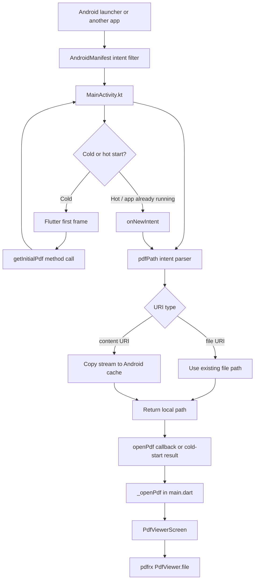

# AIFile developer flow map

Created: **2026-10-22 01:02:26 PKT (Asia/Karachi, UTC+05:00)**

This document describes the current project structure and the path a PDF takes through the application. Line numbers refer to the files as they existed at the timestamp above. Add a new timestamped note when the code changes.

## Folder map

```text
aifile/
├── lib/
│   ├── main.dart                         # App entry, channel listener, routing
│   └── screens/
│       ├── file_selection_screen.dart    # Pick a PDF from the device
│       └── pdf_viewer_screen.dart        # Render a PDF file
├── android/app/src/main/
│   ├── AndroidManifest.xml                # Android launcher and PDF intent filters
│   └── kotlin/com/example/aifile/
│       └── MainActivity.kt                # Intent reader and Flutter channel
├── android/app/build.gradle.kts           # Android/Kotlin build configuration
├── pubspec.yaml                            # Flutter dependencies and metadata
├── test/widget_test.dart                   # Existing widget test
├── PROJECT_CHANGELOG.md                    # Timestamped implementation notes
└── PROJECT_FLOW.md                         # This developer flow document
```

The `ios/`, `macos/`, `linux/`, `windows/`, and `web/` folders are generated platform runners. The PDF intent bridge described here is Android-specific because `MainActivity.kt` and Android intent filters are used.

## Runtime flow



Normal in-app selection follows a separate Flutter-only path:

```mermaid
flowchart LR
    A[FileSelectionScreen add button] --> B[FilePicker.pickFile]
    B --> C{PDF path exists?}
    C -->|Yes| D[Navigator.push]
    D --> E[PdfViewerScreen(filePath)]
    C -->|No| F[Invalid File Path dialog]
    E --> G[pdfrx PdfViewer.file]
```

## File and code responsibilities

### `lib/main.dart`

| Lines | Code/function | Responsibility |
|---|---|---|
| 6–8 | `main()` | Starts `AIFile`. |
| 10–14 | `AIFile` | Stateful root widget so the channel handler has a lifecycle. |
| 17–19 | `_AIFileState`, `_channel`, `_navigatorKey` | Owns the `aifile/pdf` channel and navigation access. |
| 21–33 | `initState()` | Registers `openPdf` and `pdfError`; schedules cold-start loading after the first frame. |
| 35–43 | `_loadInitialPdf()` | Calls Kotlin's `getInitialPdf`; ignores the channel on unsupported platforms and handles platform errors. |
| 45–51 | `_openPdf(String? path)` | Validates the path and pushes `PdfViewerScreen` while retaining the home route. |
| 53–70 | `_showError()` | Displays a simple unreadable-PDF dialog. |
| 72–76 | `dispose()` | Removes the channel callback. |
| 78–86 | `build()` | Creates `MaterialApp`, attaches `_navigatorKey`, and uses `FileSelectionScreen` as home. |

Important shared values:

```dart
// main.dart:18
static const _channel = MethodChannel('aifile/pdf');
```

The string must match the Kotlin channel name at `MainActivity.kt:15`. The method names are also part of the contract: `getInitialPdf`, `openPdf`, and `pdfError`.

### `lib/screens/file_selection_screen.dart`

| Lines | Code/function | Responsibility |
|---|---|---|
| 5–6 | `FileSelectionScreen` | Stateless home screen. |
| 10–14 | `_selectFile()` and `FilePicker.pickFile` | Opens the picker and restricts the selection to PDF extensions. |
| 17–28 | Valid path branch | Pushes `PdfViewerScreen` with the selected path. |
| 29–45 | Invalid path branch | Shows an `Invalid File Path` dialog. |
| 51–59 | `build()` | Shows the floating add button that starts `_selectFile`. |

### `lib/screens/pdf_viewer_screen.dart`

| Lines | Code/function | Responsibility |
|---|---|---|
| 7–9 | `PdfViewerScreen` and `filePath` | Receives the path that either file picker or Android intent handling produced. |
| 11–14 | `build()` | Passes the path to `PdfViewer.file` from `pdfrx`. |

### `android/app/src/main/kotlin/com/example/aifile/MainActivity.kt`

| Lines | Code/function | Responsibility |
|---|---|---|
| 10–11 | `MainActivity`, `channel` | Android activity and native channel reference. |
| 13–27 | `configureFlutterEngine()` | Creates `MethodChannel("aifile/pdf")` and answers `getInitialPdf`. |
| 29–37 | `onNewIntent()` | Receives hot-start VIEW/SEND intents and invokes Flutter's `openPdf` callback. |
| 39–47 | `pdfPath()` intent selection | Reads `ACTION_VIEW` data or `ACTION_SEND` stream; returns null for normal launcher starts. |
| 48 | File URI branch | Returns the existing `file` URI path directly. |
| 50–55 | Content URI branch | Copies the URI stream to a temporary cache PDF and returns its absolute path. |

The native-to-Dart contract is:

```text
Flutter -> Kotlin: getInitialPdf
Kotlin -> Flutter: String? local path, or PDF_ERROR
Kotlin -> Flutter: openPdf(String local path) for a hot intent
Kotlin -> Flutter: pdfError(String? message) when hot reading fails
```

### `android/app/src/main/AndroidManifest.xml`

The activity uses `android:launchMode="singleTop"`, allowing a running activity to receive `onNewIntent`. Its existing filters are:

| Filter | Purpose |
|---|---|
| `MAIN` + `LAUNCHER` | Starts the application normally. |
| `VIEW` + `application/pdf` + `content`/`file` | Allows another app or file browser to open a PDF in AIFile. |
| `SEND` + `application/pdf` | Allows another app's Share action to send a PDF to AIFile. |

## Cold-start sequence

1. Android starts `MainActivity` and retains the incoming intent.
2. Flutter constructs `AIFile` and runs `_AIFileState.initState()` (`main.dart:21–33`).
3. After the first frame, `_loadInitialPdf()` calls `getInitialPdf` (`main.dart:35–37`).
4. Kotlin calls `pdfPath(intent)` (`MainActivity.kt:39–56`).
5. Kotlin returns null for a normal launcher or a local path for a PDF.
6. Flutter calls `_openPdf()` and pushes `PdfViewerScreen` (`main.dart:45–50`).

## Hot-start sequence

1. A PDF is opened or shared while AIFile is already running.
2. Android calls `MainActivity.onNewIntent()` (`MainActivity.kt:29–37`).
3. `pdfPath()` extracts the URI and copies content URIs to cache if needed.
4. Kotlin invokes `openPdf` over `aifile/pdf`.
5. The Dart handler calls `_openPdf()` and displays the new document.

## Error and edge paths

- No incoming PDF: `pdfPath()` returns null; the file-selection home remains visible.
- Unreadable initial PDF: Kotlin returns `PDF_ERROR`; Dart catches `PlatformException` and calls `_showError()`.
- Unreadable hot PDF: Kotlin invokes `pdfError`; Dart displays the same dialog.
- Missing plugin on non-Android: `_loadInitialPdf()` catches `MissingPluginException` and leaves the app usable.
- Empty picker path: `FileSelectionScreen` shows its existing invalid-path dialog.

## Build and maintenance notes

`pubspec.yaml` supplies `file_picker` for in-app selection and `pdfrx` for rendering. `android/app/build.gradle.kts` provides the Android/Kotlin/Flutter build setup and Java/Kotlin 17 settings. The manifest and Kotlin code must remain consistent with the channel and intent names documented above.

At this documentation timestamp, Flutter analysis/build verification was not available because the configured Flutter executable could not be found. Device testing should cover normal launch, cold PDF open, hot PDF open, Share PDF, invalid paths, and unreadable files.

## Documentation history

| Date and time (PKT) | Change |
|---|---|
| 2026-10-22 01:02:26 | Created this developer flow map for the current source tree and PDF intent implementation. |
