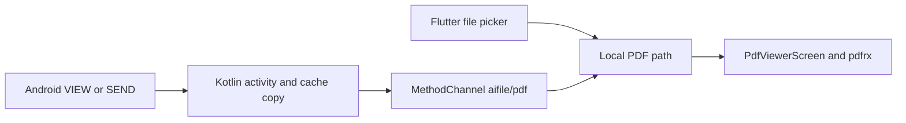

# AIFile

A Flutter document utility with an implemented PDF viewing workflow and Android “Open with” and Share integration.

The current application focuses on opening local PDFs. Support for editing documents, additional office formats, and AI tools is a product direction rather than an implemented capability.

## Mobile interface preview

The intentionally minimal entry screen provides a single file-selection action; once a PDF is chosen or shared from Android, the document becomes the full-screen experience.

<p align="center">
  
</p>

## Features

- Select a PDF using the native file picker.
- Render local documents with `pdfrx`.
- Receive Android PDF VIEW and SEND intents at cold start or while the app is running.
- Show errors when a shared document cannot be read.

## Stack and architecture

Flutter / Dart, Material widgets, `file_picker`, `pdfrx`, and a Kotlin Android platform bridge. The Dart SDK constraint is `^3.10.8`; see [pubspec.yaml](pubspec.yaml) and the checked-in lockfile.



`lib/main.dart` owns navigation and the channel lifecycle. The selection screen passes a path to the viewer. Android content URIs are copied to cache by the native bridge so the renderer receives a local path. There is no application backend, account system, or cloud document store in this workflow.

## Local setup

Install Flutter with a compatible Dart SDK, Android SDK, and an emulator or USB-debugging device.

```sh
git clone https://github.com/Abdul-Hadi-Jalil/AIFile.git
cd AIFile
flutter doctor
flutter pub get
flutter devices
flutter run -d <device-id>
```

No API keys or environment variables are required for the PDF workflow. Android is the relevant target for native intent handling. Other platform runners exist, but their presence does not establish feature parity; the path-based picker and renderer need platform-specific verification.

## Project map

| Path | Responsibility |
| --- | --- |
| `lib/main.dart` | App bootstrap, channel callbacks, cold-start handling |
| `lib/screens/file_selection_screen.dart` | PDF selection and path validation |
| `lib/screens/pdf_viewer_screen.dart` | Local PDF rendering |
| `android/app/src/main/` | Intent filters and Kotlin bridge |
| `test/` | Existing Flutter widget tests |

## Checks and demo

```sh
flutter analyze
flutter test
flutter build apk --debug
```

For a demonstration, open a PDF inside the app, then open and share one from an Android file manager. Repeat with the app closed and running, cancel the picker, and try an unreadable document. Shared PDFs can create cache copies on the device.

See [developer flow](PROJECT_FLOW.md) for the detailed native/Dart contract and [implementation history](PROJECT_CHANGELOG.md) for earlier changes. Historical verification notes describe their own snapshots; the commands above are checks to run on your configured machine.
